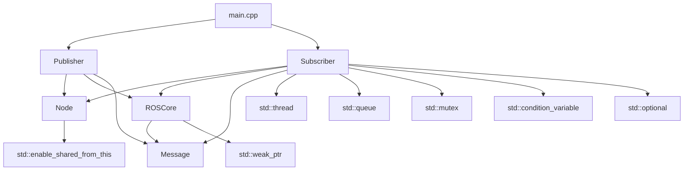
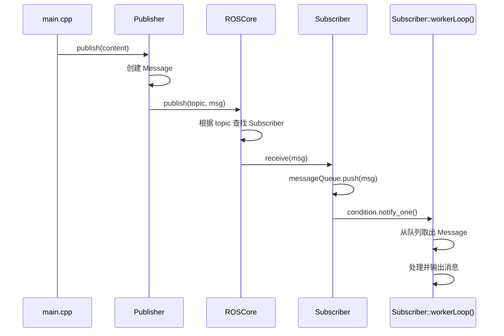

# ROS Topic 通信模拟系统——架构设计文档

## 系统总体架构

本项目采用分层模块设计：

- `Message`：负责消息封装和时间戳生成。
- `Node`：所有节点的抽象基类，定义节点统一接口。
- `Publisher`：负责发布消息。
- `Subscriber`：负责接收消息并异步处理。
- `ROSCore`：负责节点注册、Topic 管理和消息转发。
- `main.cpp`：程序入口，创建节点并驱动整个通信演示流程。



## 模块划分

### Message

`Message` 表示一条消息。

- 保存消息内容 `content`
- 保存消息时间戳 `timestamp`
- 构造函数中检查空消息
- 提供 `getContent()` 和 `getTimestamp()` 接口

### Node

`Node` 是所有节点的抽象基类。

- 保存节点名称 `name`
- 定义 `init()` 和 `shutdown()` 纯虚函数
- 支持 `shared_from_this()`
- 通过 `std::enable_shared_from_this<Node>` 支持向 `ROSCore` 注册自身

### Publisher

`Publisher` 继承 `Node`，表示消息发布者。

- 绑定一个 Topic
- 初始化时向 `ROSCore` 注册
- 发布消息时创建 `Message` 并交给 `ROSCore`
- 关闭时从 `ROSCore` 注销

### Subscriber

`Subscriber` 继承 `Node`，表示消息订阅者。

- 绑定一个 Topic
- 初始化时向 `ROSCore` 注册并启动工作线程
- 收到消息时先放入队列
- 工作线程负责取出消息并处理
- 关闭时停止线程并等待退出

### ROSCore

`ROSCore` 是全局核心管理器。

- 采用单例模式
- 管理 Topic 到 `Publisher` 的映射
- 管理 Topic 到 `Subscriber` 的映射
- 管理已注册节点名称
- 负责消息转发
- 支持节点注销和统一关闭

## Message 类设计

`Message` 的设计目标是把“消息内容”和“消息时间”封装在一起。

```cpp
class Message
{
private:
    std::string content;
    std::string timestamp;
public:
    explicit Message(const std::string& msg);
    const std::string& getContent() const;
    const std::string& getTimestamp() const;
};
```

设计要点：

- `content` 和 `timestamp` 均为私有成员，外部不能直接修改。
- 构造函数中拒绝空消息。
- 时间戳在构造时生成。
- `getContent()` 和 `getTimestamp()` 返回 `const std::string&`，避免复制。

## Node 类设计

`Node` 是所有节点的抽象基类。

```cpp
class Node : public std::enable_shared_from_this<Node>
{
protected:
    std::string name;
public:
    explicit Node(const std::string& name);
    const std::string& getName() const;
    virtual void init() = 0;
    virtual void shutdown() = 0;
    virtual ~Node() = default;
};
```

设计要点：

- 节点名称不能为空。
- `init()` 和 `shutdown()` 是必须实现的接口。
- 继承 `std::enable_shared_from_this<Node>`，支持对象自身获取 `shared_ptr`。

## Publisher 类设计

`Publisher` 的设计重点是把“消息发布动作”和“节点注册动作”分开。

```cpp
class Publisher : public Node
{
private:
    std::string topic;
    std::atomic<bool> active{false};
public:
    Publisher(
        const std::string& name,
        const std::string& topic
    );
    void init() override;
    void shutdown() override;
    void publish(const std::string& content);
    ~Publisher() override;
};
```

设计要点：

- 构造函数校验 Topic 非空。
- `init()` 时向 `ROSCore` 注册。
- `publish()` 前检查是否已初始化。
- `active` 使用 `std::atomic<bool>`，避免多线程状态竞态。
- 析构函数调用 `shutdown()`。

## Subscriber 类设计

`Subscriber` 的设计重点是“接收”和“处理”分离。

```cpp
class Subscriber : public Node
{
private:
    std::string topic;
    std::queue<Message> messageQueue;
    std::mutex queueMutex;
    std::condition_variable condition;
    std::thread worker;
    bool stopping = false;
    std::atomic<bool> active{false};
    void workerLoop();
public:
    Subscriber(
        const std::string& name,
        const std::string& topic
    );
    void init() override;
    void shutdown() override;
    void receive(const Message& msg);
    ~Subscriber() override;
};
```

设计要点：

- `messageQueue` 负责暂存收到的消息。
- `queueMutex` 保护共享队列。
- `condition` 负责通知工作线程。
- `worker` 是独立处理线程。
- `stopping` 表示是否要求停止线程。
- `active` 表示节点当前是否处于活动状态。
- `workerLoop()` 中使用 `std::optional<Message>` 暂存从队列取出的消息。

## ROSCore 类设计

`ROSCore` 是整个系统的核心管理器。

```cpp
class ROSCore
{
private:
    std::map<
        std::string,
        std::vector<std::weak_ptr<Publisher>>
    > publishers;
    std::map<
        std::string,
        std::vector<std::weak_ptr<Subscriber>>
    > subscribers;
    std::map<
        std::string,
        std::weak_ptr<Node>
    > nodes;
    std::mutex coreMutex;
    ROSCore() = default;
public:
    static ROSCore& getInstance();
    ROSCore(const ROSCore&) = delete;
    ROSCore& operator=(const ROSCore&) = delete;
    void registerPublisher(
        const std::string& topic,
        const std::shared_ptr<Publisher>& publisher
    );
    void registerSubscriber(
        const std::string& topic,
        const std::shared_ptr<Subscriber>& subscriber
    );
    void publish(
        const std::string& topic,
        const Message& msg
    );
    void unregisterNode(const std::string& name);
    void shutdownAll();
};
```

设计要点：

- `getInstance()` 使用函数内静态对象实现单例。
- 拷贝构造和赋值都删除。
- 使用 `std::weak_ptr` 管理节点引用，避免 `ROSCore` 长期持有节点对象。
- `publish()` 中先加锁取出目标，再释放锁后调用 `receive()`，避免持锁时间过长。
- `shutdownAll()` 先加锁收集活动节点，再释放锁后逐个关闭，避免持锁调用节点关闭函数。

## 类之间的关系

- `Publisher` 继承 `Node`
- `Subscriber` 继承 `Node`
- `ROSCore` 通过 `std::weak_ptr<Publisher>` 管理发布者
- `ROSCore` 通过 `std::weak_ptr<Subscriber>` 管理订阅者
- `ROSCore` 通过 `std::weak_ptr<Node>` 管理所有已注册节点
- `main.cpp` 创建智能指针对象，并驱动整个通信流程

## 消息通信流程



流程说明：

- `Publisher` 不直接调用 `Subscriber`，而是把消息交给 `ROSCore`。
- `ROSCore` 根据 Topic 决定转发给哪些 `Subscriber`。
- `Subscriber` 收到消息后先进入队列，不立即处理。
- 工作线程从队列取出消息后再处理。

## 节点注册和注销流程

### 注册

- `Publisher::init()` 调用 `ROSCore::registerPublisher()`
- `Subscriber::init()` 调用 `ROSCore::registerSubscriber()`
- `ROSCore` 检查节点名称是否重复
- 节点名称合法时，将节点写入 `nodes`，并将 Topic 关系写入 `publishers` 或 `subscribers`

### 注销

- 节点关闭时调用 `ROSCore::unregisterNode()`
- `ROSCore` 从 `nodes`、`publishers`、`subscribers` 中移除该节点信息

## 多线程架构

- 每个 `Subscriber` 都有独立工作线程。
- 主线程负责创建节点、发布消息和统一关闭。
- `Subscriber` 工作线程负责消费队列中的消息。
- `queueMutex` 保护 `messageQueue`、`stopping` 和条件变量逻辑。
- `condition` 用于在工作线程等待消息时避免忙等待。

```mermaid
graph LR
A[main 主线程] --> B[Publisher.publish()]
B --> C[ROSCore.publish()]
C --> D[Subscriber.receive()]
D --> E[messageQueue]
E --> F[condition.notify_one()]
F --> G[Subscriber worker 线程]
G --> H[取出并处理消息]
```

## 对象生命周期管理

- `main.cpp` 中通过 `std::make_shared` 创建节点。
- `Node` 继承 `std::enable_shared_from_this`，使节点能获取自身 `shared_ptr`。
- `ROSCore` 使用 `std::weak_ptr` 保存节点引用，避免核心对象长期阻止节点析构。
- 节点关闭时先从 `ROSCore` 注销，再由对象生命周期管理最终释放。

## 异常处理架构

当前系统中的异常处理集中在以下场景：

- `Message` 空消息：抛出 `std::invalid_argument`
- `Node` 空节点名称：抛出 `std::invalid_argument`
- `Publisher` 空 Topic：抛出 `std::invalid_argument`
- `Subscriber` 空 Topic：抛出 `std::invalid_argument`
- `Publisher` 未初始化就发布：抛出 `std::runtime_error`
- `ROSCore` 重复节点名称：抛出 `std::runtime_error`
- `Subscriber` 创建线程失败：捕获后回滚注册并继续抛出

`main.cpp` 中对主流程异常进行统一捕获并输出错误信息。
